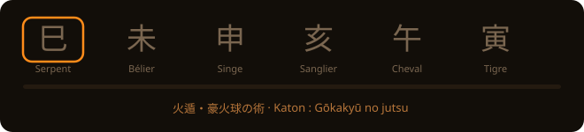

<div align="center">



### Tu fais le geste devant ta caméra. Une IA le reconnaît. La technique part à l'écran.

<br>

<a href="https://github.com/CodeByHaamza/kagami/actions/workflows/ci.yml"></a>


</div>

---

## Ce que c'est

**Kagami** (鏡, « le miroir ») est un moteur : ta webcam devient une glace où tu te vois
avec les pouvoirs. Il ne connaît aucun anime — il sait lire des **jetons** (un geste
reconnu), les assembler en **techniques**, et dessiner l'effet par-dessus ton image.

Chaque anime est un **pack** : son modèle de reconnaissance, son catalogue, ses effets,
ses textes. Ajouter un anime, c'est ajouter un dossier, pas rouvrir le moteur.

<div align="center">

| | Pack | Anime | Ce qu'on y fait | État |
| :---: | --- | --- | --- | :---: |
| 型 | [**Kata**](src/packs/naruto/) | Naruto | 14 signes, 52 jutsus, 7 taijutsu, 3 armes, 5 missions d'arcade | **disponible** |
| 気 | — | Dragon Ball | poses du corps, montée de ki | envisagé |
| 呪 | — | Jujutsu Kaisen | gestes, extension du territoire | envisagé |
| 波 | — | JoJo | poses | envisagé |

</div>

## Essayer

```bash
git clone https://github.com/CodeByHaamza/kagami.git
cd kagami
git lfs pull     # les modèles de reconnaissance sont suivis par Git LFS
npm install
npm run dev      # puis http://localhost:5173
```

Il faut une webcam et un navigateur récent. La caméra exige `https` ou `localhost` :
c'est une règle des navigateurs, pas du projet. Rien ne sort de ta machine — ton image
ne quitte jamais l'onglet.

Pas de webcam sur la machine ? `npm run dev:reseau` sert l'appli en **HTTPS** sur le
réseau local : on l'ouvre depuis un téléphone, on accepte l'avertissement du certificat
auto-signé une fois, et la caméra du téléphone fait l'affaire.

Avec Docker :

```bash
docker compose up dev            # développement, http://localhost:5173
docker compose up --build web    # version construite, http://localhost:8080
```

## Comment ça marche

```text
         ┌─ reconnaisseur de jetons ─→ jetons ─→ grammaire ─→ technique ─┐
caméra ──┤                                                               ├─→ scène ─→ rendu
         └─ lecteur de posture ──────→ posture, gestes ──→ action ───────┘
```

Deux boucles tournent en parallèle : la **détection** (12 fois par seconde au plus, le
modèle est le facteur limitant) et l'**affichage** (à chaque image de l'écran). Un jeton
n'est validé que s'il est vu sur deux images d'affilée — le modèle se trompe d'une image
à l'autre, et sans ce filtre rien ne serait jouable.

Seules deux pièces sont propres à un anime : le reconnaisseur et le catalogue. Une règle
de lint interdit à `src/moteur/` d'importer quoi que ce soit de `src/packs/`, et un test
la vérifie.

### Deux postures, deux alphabets

Les mains servent à la fois à former les sceaux et à frapper : un direct serait lu comme
un signe raté. La posture du corps tranche, et c'est elle qui décide **qui écoute**.

| Posture | Ce qui écoute | Comment on y entre |
| --- | --- | --- |
| 印 **concentration** | les signes de mains | poignets joints devant le corps |
| 戦 **combat** | les gestes du corps | poignets hauts, ou garde de boxe |
| — **neutre** | rien | tout le reste |

C'est une solution technique — trois modèles ne tiennent pas la cadence ensemble — qui
se trouve être la règle de l'œuvre : former des sceaux prend du temps et laisse ouvert.
Le jeu hérite gratuitement de la tension qui fait qu'un ninja s'interrompt en pleine
incantation.

Les gestes du corps sont un **second alphabet pour la même grammaire** : frapper,
garder, lancer, tourner, sauter, esquiver. Le taijutsu s'assemble exactement comme un
jutsu — `directG`, `directD`, `coupDePied`, `coupDePied` donne le Shishi Rendan. Toutes
les mesures sont normalisées en largeurs d'épaules, pour qu'un seuil vaille pareil à un
mètre de la caméra et à trois.

### Le banc de rejeu

Régler un seuil de geste en bougeant devant une webcam jusqu'à ce que ça marche n'est ni
reproductible ni mesurable. Le banc enregistre ce que la caméra montre, l'écrit dans un
fichier, et le **rejoue à la place de la caméra** — le moteur ne voit pas la différence.
Il s'ouvre avec `?banc` dans l'adresse, et affiche en direct la posture, le dernier
geste, le dernier jeton, l'immobilité et la fiabilité des points.

<div align="center">

<br><sub>Six signes à la suite, chacun tenu une demi-seconde. Le curseur avance quand le modèle valide.</sub>
</div>

## La pile

| Quoi | Avec quoi |
| --- | --- |
| Reconnaissance des signes | [YOLOX-Nano](https://github.com/Kazuhito00/NARUTO-HandSignDetection) via onnxruntime-web (WebAssembly) |
| Détourage de la personne | [MediaPipe Image Segmenter](https://ai.google.dev/edge/mediapipe/solutions/vision/image_segmenter) |
| Lecture du corps | [MediaPipe Pose Landmarker](https://ai.google.dev/edge/mediapipe/solutions/vision/pose_landmarker), 33 points |
| Effets | Canvas 2D, et Three.js pour le Rasengan |
| Build et tests | Vite · TypeScript strict · Vitest · Playwright |

Tout tourne dans le navigateur. Pas de serveur, pas de compte, aucune donnée qui sorte.

## Développer

```bash
npm run dev        # serveur de développement
npm run dev:reseau # le même en HTTPS sur le réseau local, pour essayer au téléphone
npm test           # 410 tests unitaires + vérification des types
npm run test:e2e   # 26 tests dans un vrai navigateur (démarrer npm run dev à côté)
npm run lint       # ESLint, dont la règle moteur ↛ packs
npm run build      # sortie statique dans dist/
```

Le **banc de rejeu** s'ouvre sur `http://localhost:5173/?banc` : il enregistre une
session, la rejoue à la place de la caméra, et montre les nombres sur lesquels on règle
les seuils de gestes. Ils sont dans `src/moteur/corps/` — `SEUILS` pour les postures,
`REGLAGES_PAR_DEFAUT` pour les mouvements — et ce sont des points de départ, pas des
mesures.

Pour ajouter un jutsu, un effet ou un pack entier : [CONTRIBUTING.md](CONTRIBUTING.md).
Les conventions du dépôt sont dans [CLAUDE.md](CLAUDE.md).

## Feuille de route

- [x] **1** — extraction, TypeScript, tests, séparation moteur / packs
- [x] **2** — lecture du corps : postures, taijutsu, armes, banc de rejeu
- [x] **3** — arcade : vagues, boss, cycle élémentaire, HUD parchemin, ralenti d'incantation
- [x] **4** — progression : grades, examens, fiche ninja, contrats d'invocation, chrono du Dojo
- [ ] **5** — contenu et assets : signes dessinés, silhouettes à l'encre, nouveaux jutsus
- [ ] **6** — finition : démo en ligne, enregistreur de clip, README avec de vraies images de jeu

La conception complète est dans [`docs/superpowers/specs/`](docs/superpowers/specs/),
les plans dans [`docs/superpowers/plans/`](docs/superpowers/plans/).

## Licence et crédits

Le code est sous [licence MIT](LICENSE). Les œuvres dont s'inspirent les packs ne le sont
pas : **NARUTO © Masashi Kishimoto / Shueisha**. Projet de fan, non officiel, non
commercial.

> ⚠️ Les illustrations des douze signes sont découpées d'une planche de captures de
> l'anime, à titre de **référence provisoire**. Elles doivent être remplacées par nos
> propres visuels avant que le dépôt devienne public. Tout le reste — sons, effets,
> bannières — est fabriqué pour le projet.

- Modèle de détection : [NARUTO-HandSignDetection](https://github.com/Kazuhito00/NARUTO-HandSignDetection) de Kazuhito Takahashi, licence MIT
- Détourage : [MediaPipe](https://ai.google.dev/edge/mediapipe), licence Apache 2.0

---

<div align="center">

<a href="https://github.com/CodeByHaamza">
  
</a>

### [CodeByHaamza](https://github.com/CodeByHaamza)

<a href="https://github.com/CodeByHaamza"></a>
<a href="https://github.com/CodeByHaamza/kagami/stargazers"></a>

<sub>Si tu fais un Rasengan correct du premier coup, dis-le-moi.</sub>

</div>
