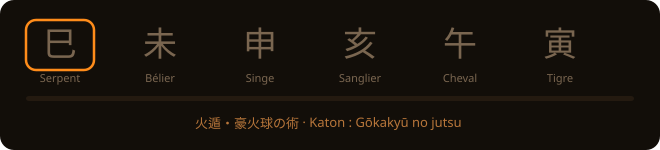
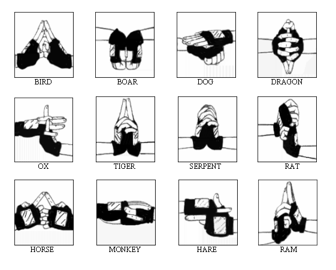
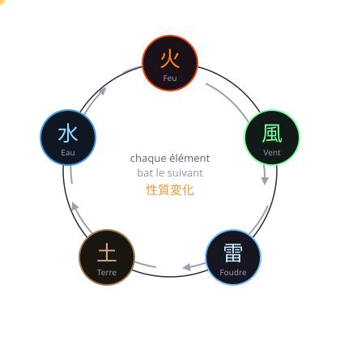

**印を結べ。** · *Forme les sceaux.*

*Un pack pour [**Kagami**](../../../README.md).*

---

Tu fais les signes devant ta webcam. Un YOLOX-Nano entraîné sur les 14 sceaux les
reconnaît, et le bon enchaînement lance l'un des **52 jutsus** : boule de feu, Chidori,
Rasengan, clones, invocations, mur de terre, Tsukuyomi, Amaterasu.

### 火遁・豪火球の術

Six signes à la suite, chacun tenu une demi-seconde. Le curseur avance quand le modèle valide.

## 十四印 · Les quatorze signes

Les douze signes du zodiaque chinois, plus deux signes particuliers.

> **Sur cette planche :** c'est une référence trouvée en ligne, d'origine inconnue, qui
> sert à montrer les positions. Elle ne couvre que les douze signes du zodiaque — il
> manque 祈 Gasshō et 壬 Mizunoe — et elle est **destinée à être remplacée** par nos
> propres visuels, en même temps que les silhouettes d'ennemis (plan 5).

| | | | | | | |
| :---: | :---: | :---: | :---: | :---: | :---: | :---: |
| 子 | 丑 | 寅 | 卯 | 辰 | 巳 | 午 |
| **Rat** Ne | **Bœuf** Ushi | **Tigre** Tora | **Lièvre** U | **Dragon** Tatsu | **Serpent** Mi | **Cheval** Uma |
| 未 | 申 | 酉 | 戌 | 亥 | 祈 | 壬 |
| **Bélier** Hitsuji | **Singe** Saru | **Oiseau** Tori | **Chien** Inu | **Sanglier** I | **Mains jointes** Gasshō | **Mizunoe** eau |

Le **Bélier** a un rôle à part : c'est le signe du **Kai** (解). Pris dans un genjutsu,
c'est lui qui te libère — comme dans l'œuvre. C'est aussi le geste le plus reconnaissable
de la série : deux doigts dressés devant le visage, le **sceau de l'affrontement**.

> **Et le sceau en croix de Naruto ?** Celui du Kage Bunshin, deux mains croisées en
> croix, n'est **pas reconnu** : le modèle a été entraîné sur ces quatorze classes et
> sur aucune autre. L'ajouter demanderait de réentraîner le détecteur. Le `bunshin` du
> catalogue part donc de ses vrais sceaux canon — 未 Bélier, 巳 Serpent, 寅 Tigre.

## 性質変化 · Le cycle élémentaire

Chaque élément bat le suivant dans le sens horaire : Feu ▶ Vent ▶ Foudre ▶ Terre ▶ Eau ▶
Feu. En mode arcade, chaque déserteur et chaque boss a une affinité : taper avec
l'élément fort double les dégâts, avec le faible les divise par deux.

## 任務 · Le mode arcade

Cinq missions, rangs canon **D à S** (3, 5, 10, 15 et 20 vagues). Les ennemis arrivent
derrière ta silhouette détourée ; chaque boss annonce ses attaques par un télégraphe où
l'élément s'affiche en clair, et quatre réponses sont possibles : esquiver au corps,
garder, contrer avec une défense (ou le Kawarimi), ou abattre la source avant l'impact.

| Rang | Vagues | Boss | Ce qu'il force à apprendre |
| :---: | :---: | --- | --- |
| **D** | 3 | — | le cycle élémentaire sur les déserteurs |
| **C** | 5 | **Zabuza Momochi** | lire un télégraphe Suiton et garder |
| **B** | 10 | Zabuza, puis **Kisame Hoshigaki** | Samehada draine le chakra → taijutsu et armes gratuites |
| **A** | 15 | Kisame, **Deidara**, **Itachi Uchiha** | esquiver l'argile explosive, rompre le genjutsu au Bélier (« Kai ! ») |
| **S** | 20 | les quatre + **Madara Uchiha** | enchaîner les cinq éléments sous ralenti d'incantation |

Entrer en **posture de concentration** ralentit les ennemis et les télégraphes (×0,35)
le temps de former un enchaînement long — sans jamais les geler.

## 忍術 · Les cinquante-deux jutsus

| Famille | Combien | Quelques-uns |
| --- | :---: | --- |
| 火遁 **Katon** · feu | 6 | Gōkakyū · Hōsenka · Karyū Endan · Gōka Mekkyaku |
| 水遁 **Suiton** · eau | 7 | Suiryūdan **(44 signes)** · Daibakufu · Kirigakure |
| 雷遁 **Raiton** · foudre | 3 | Chidori · Jinraisen · Kirin |
| 風遁 **Fūton** · vent | 7 | Daitoppa · Kamaitachi · Rasengan · Rasenshuriken |
| 土遁 **Doton** · terre | 4 | Doryūheki · Doryūdan · Doryūsō |
| 木遁 **Mokuton** · bois | 3 | Shichūrō · Jukai Kōtan |
| 忍術 **Ninjutsu** | 7 | Bunshin · Kawarimi · Shunshin · Kagemane |
| 口寄せ **Kuchiyose** | 3 | l'invocation du crapaud · Rashōmon |
| 幻術 **Genjutsu** | 2 | Narakumi · Jubaku Satsu |
| 封印術 **Fūinjutsu** | 2 | Shiki Fūjin · Fūja Hōin |
| 医療忍術 **Iryō** | 2 | Shōsen · scalpel de chakra |
| 瞳術 **Dōjutsu** | 5 | Tsukuyomi · Amaterasu · Susanoo · Kamui · Izanagi |

Le défi du pack reste le **Suiryūdan de Zabuza** : quarante-quatre signes d'affilée,
sans en rater un.

## 体術 · Les sept taijutsu

Au corps, sans un seul signe. Le lecteur de posture lit les gestes, et la **même
grammaire** les assemble : un enchaînement de coups vaut un enchaînement de sceaux.

Pour y accéder, il faut être en **posture de combat** — poignets au-dessus des épaules,
ou garde de boxe. Tant qu'on y est, les signes ne sont plus écoutés, et réciproquement.

| | Technique | Ce qu'on fait |
| --- | --- | --- |
| 木ノ葉旋風 | **Konoha Senpū** | deux coups de pied |
| 獅子連弾 | **Shishi Rendan** | gauche, droite, deux coups de pied |
| 牙通牙 | **Gatsūga** | une rotation, tenue |
| 八卦掌回天 | **Hakkeshō Kaiten** | une rotation, puis la garde |
| 表蓮華 | **Omote Renge** | sauter, puis frapper du pied |
| 八卦六十四掌 | **Hakke Rokujūyon Shō** | huit frappes en trois secondes |
| 八門遁甲 | **Hachimon Tonkō** | bras croisés, tenus — une porte par palier |

Les **Huit Portes** ne s'ouvrent pas encore jusqu'à la huitième : celle-là tue, et elle
attend qu'il y ait une progression à laquelle accrocher le pari (plan 4).

## 忍具 · Les armes

Elles règlent un vrai problème de jeu : jauge de chakra vide, sans elles le joueur reste
planté à regarder les ennemis arriver. Elles sont donc **gratuites** — et c'est canon,
le lancer est la base enseignée à l'Académie.

| | Arme | Dégâts | Stock |
| --- | --- | :---: | --- |
| 手裏剣 | **Shuriken** | 6 | illimité |
| 苦無 | **Kunai** | 11 | illimité |
| 起爆札 | **Kibaku Fuda** · parchemin explosif | 34 | 5 par mission |

Les trois partent du **même geste** : le bras droit qui se détend depuis le haut. Un
seul mouvement de lancer existe dans la nature, et prétendre distinguer un shuriken d'un
kunai à la trajectoire du poignet serait inventer. C'est l'arme **sélectionnée** qui
part — touche `A` pour en changer, en attendant que le mode arcade lui donne sa place.

## 階級 · Les grades et la progression

La progression ninja suit rigoureusement l'échelle de l'œuvre (§9.8) :

| Grade | Titre | Déblocages jutsus | Déblocages missions | Comment monter |
| :---: | --- | :---: | :---: | --- |
| 忍生 | **Académie** | Rang E | Rang D | Examen Genin (Bunshin no Jutsu) |
| 下忍 | **Genin** | Rangs E, D, C | Rangs D, C | Examen Chūnin (après mission C) |
| 中忍 | **Chūnin** | Rangs E, D, C, B | Rangs D, C, B | Recommandation (mission B + 8 jutsus) |
| 上忍 | **Jōnin** | Rangs E à A | Rangs D à S | Recommandation Kage (mission S) |
| 影 | **Kage** | Tous + rang S et ultimes | Rangs D à S | Sommet shinobi atteint |

## 契約 · Les quatre contrats d'invocation

Chaque contrat d'invocation confère une spécialité active ou passive en combat (§9.10) :

- **Crapauds (Mont Myōboku)** : Mode Ermite — boost d'attaque ×1.5 sous concentration.
- **Serpents (Grotte Ryūchi)** : Réflexe ermite — mue et substitution esquivant toute attaque.
- **Limaces (Forêt Shikkotsu)** : Soin de Katsuyu — régénération vitale passive permanente.
- **Chiens ninja (Ninken)** : Pistage olfactif — anticipation accrue et ralentissement des télégraphes ennemis.

## Comment on joue

1. Mains bien visibles, à hauteur de poitrine, dans un endroit éclairé.
2. Tiens chaque signe une demi-seconde : un « toc » le valide.
3. Quelques jutsus n'ont qu'un signe : tiens-le 2,5 secondes.
4. Pris dans un genjutsu ? Fais le Bélier.
5. Pour frapper au corps, lève les poings : les signes se taisent, les gestes comptent.

L'**encyclopédie** 📜 donne tous les enchaînements et garde une photo de chaque signe que
tu réussis. Le mode **entraînement** t'en fait répéter un en te montrant le suivant et
mesure ta vitesse au **chronomètre du Dojo**.

## Sous le capot

| | |
| --- | --- |
| `donnees/` | les 14 signes, les 52 jutsus, les 7 taijutsu, les 3 armes, les examens canoniques, les familles. Kanji et romaji seulement : les noms traduisibles sont dans `i18n/`. |
| `entree/` | le reconnaisseur YOLOX, et le prétraitement sorti en fonctions pures |
| `effets/` | les effets des jutsus, du taijutsu et des armes, et la scène Three.js du Rasengan |
| `i18n/` | français et anglais, mêmes clés des deux côtés (un test le vérifie) |
| `manifeste.ts` | ce que le pack déclare au moteur |

Les enchaînements viennent de la [Narutopedia](https://naruto.fandom.com), sauf quelques
variantes tirées du dépôt du modèle de détection. Le Rasengan, le Rasenshuriken, Kirin et
les techniques du Sharingan n'ont pas de signes dans l'œuvre : leurs enchaînements sont
inventés pour l'appli, et marqués `source: "appli"` dans les données.

## Ce qui vient

Refonte des silhouettes à l'encre et des visuels des signes (plan 5), enregistreur de clip et cosmétiques (plan 6).
Voir la
[feuille de route](../../../README.md#feuille-de-route).

---

NARUTO © Masashi Kishimoto / Shueisha. Projet de fan, non officiel, non commercial.

